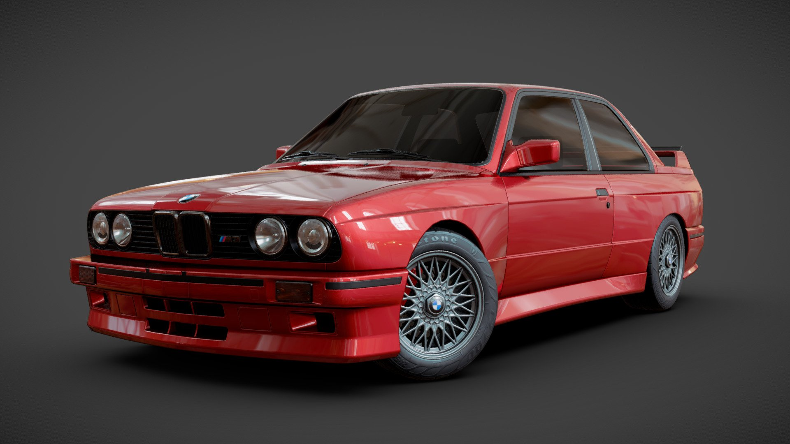

# carros



<sub>Imagem: [\[FREE\] BMW M3 E30](https://sketchfab.com/3d-models/free-bmw-m3-e30-ac3c7013434e403e8faff87948caf422) por [Martin Trafas](https://sketchfab.com/TinoD2), licença CC Attribution.</sub>

Biblioteca aberta de modelos 3D de **carros vendidos no Brasil** — antigos,
atuais e importados. Cada modelo vem com metadados prontos para uso: marca,
modelo, anos de produção, categoria, **qual material é a pintura da lataria**
(para permitir troca de cor) e a atribuição obrigatória do autor.

Não existia nada assim reunido e catalogado. Os modelos individualmente estão
espalhados pelo Sketchfab; aqui eles estão normalizados, comprimidos para web,
e descritos por um manifesto único. Cobre nacionais (Uno, Gol, Onix, Opala,
Chevette, Corcel), importados premium (Porsche, Ferrari, Rolls-Royce) e chineses
(BYD, Chery, JAC, GWM).

```
530 modelos · 57 marcas · 1.8 GB · todos com licença de uso comercial
 + 35 cenários · garagens, oficinas, showrooms, postos · 345 MB
```

## Por que existe

Quem constrói qualquer coisa com carro em 3D na web enfrenta os mesmos três
problemas, e nenhum deles é sobre modelagem:

1. **Achar modelos com licença que permita uso comercial** — a maioria do que se
   encontra é NonCommercial ou NoDerivs, inutilizável em produto.
2. **Peso** — modelos de catálogo vêm com 100k–2M triângulos, absurdo para um
   viewer de 500px. Aqui já vêm decimados e comprimidos — **mediana de -71% por
   arquivo**, metade dos casos entre -45% e -81% (`weld` → `simplify` → `prune`
   → `meshopt`).
3. **Trocar a cor da lataria** — parece trivial e não é. Cada autor nomeia os
   materiais do seu jeito (`carpaint`, `Pintura`, `kuzov`, `Material.001`,
   `g10m0`), então não existe regra genérica. Este é o problema que a biblioteca
   realmente resolve (ver [Pintura](#pintura)).

## Instalação

> **Repositório privado.** O pacote não está no npm e não há CDN público —
> jsDelivr e unpkg só servem repositórios públicos. A instalação é feita
> diretamente do Git ou por caminho local.

A biblioteca tem duas partes que se instalam de formas diferentes, e entender
isso evita a maior parte dos problemas:

| Parte | O que é | Como chega ao seu projeto |
|---|---|---|
| **Código** (129 KB compactado, 753 KB em disco) | catálogo, tipos, helpers | `npm install` |
| **Modelos** (2,1 GB) | os arquivos `.glb` | `npx carros-assets` |

Os modelos ficam fora do pacote de propósito: dois gigas em `node_modules` de
cada projeto seria inaceitável, e eles precisam ser servidos pelo seu servidor
web como arquivo estático, não importados como módulo.

### 1. Instale o pacote

```bash
# via SSH (recomendado — requer sua chave configurada no GitHub)
npm install git+ssh://git@github.com/pedrosoandre/carros.git

# via HTTPS com Personal Access Token
npm install git+https://<TOKEN>@github.com/pedrosoandre/carros.git

# ou, se já tem o repositório clonado ao lado do projeto
npm install ../carros
```

Fixe uma versão em produção, para que uma mudança no catálogo não entre sem
você querer:

```bash
npm install git+ssh://git@github.com/pedrosoandre/carros.git#v1.0.0
```

### 2. Copie os modelos para a pasta pública

```bash
npx carros-assets public/cars
```

O destino muda conforme o framework:

| Framework | Comando | URL resultante |
|---|---|---|
| Next.js | `npx carros-assets public/cars` | `/cars/fiat-uno.glb` |
| Vite | `npx carros-assets public/cars` | `/cars/fiat-uno.glb` |
| Create React App | `npx carros-assets public/cars` | `/cars/fiat-uno.glb` |
| Angular | `npx carros-assets src/assets/cars` | `/assets/cars/fiat-uno.glb` |

**Copiar só o que você usa.** Dois gigas raramente são necessários; um app de
oficina que atende carros populares não precisa de Bugatti:

```bash
npx carros-assets public/cars --brand=Fiat,Chevrolet,Volkswagen,Ford
npx carros-assets public/cars --category=hatchback,sedan,suv
npx carros-assets public/cars --only=fiat-uno,chevrolet-onix,vw-gol

# só cenários, só garagens e oficinas:
npx carros-assets public/cars --scenery-only --kind=garage,workshop
# só carros, sem cenários:
npx carros-assets public/cars --no-scenery
```

O comando é idempotente — rodar de novo não recopia o que já existe (use
`--force` para sobrescrever). Ele também copia o `CREDITS.md` junto, porque a
licença CC BY obriga você a creditar os autores.

> **Não versione os `.glb` do seu projeto.** Adicione `public/cars/` ao
> `.gitignore` e rode `carros-assets` no build. Do contrário você duplica
> gigabytes de binários no histórico do seu repositório.

### 3. Configure o decodificador (se não usar drei)

Os arquivos usam compressão **meshopt**. Com `@react-three/drei` não há nada a
fazer: o `useGLTF` já decodifica por padrão, com o decoder embutido no
`three-stdlib`. Com `GLTFLoader` puro:

```ts
import { GLTFLoader } from "three/examples/jsm/loaders/GLTFLoader.js";
import { MeshoptDecoder } from "three/examples/jsm/libs/meshopt_decoder.module.js";

const loader = new GLTFLoader();
loader.setMeshoptDecoder(MeshoptDecoder);
```

Se esquecer disso, o carregamento falha com erro de extensão não suportada —
não é um arquivo corrompido.

### Servindo de outro lugar

`DEFAULT_BASE_URL` é `/cars`. Para servir de um bucket ou CDN próprio, passe a
base em `modelUrl`:

```ts
modelUrl(car, "https://assets.suaempresa.com/carros");
```

<details>
<summary>O que muda se a biblioteca for aberta</summary>

Os 2,1 GB passariam a poder ser servidos pelo jsDelivr direto do GitHub, sem
bucket nem custo de banda, e o passo 2 se tornaria opcional:

```
https://cdn.jsdelivr.net/gh/pedrosoandre/carros@v1.0.0/assets/fiat-uno.glb
```

Duas coisas a decidir **antes** de abrir: (1) a obrigação de crédito CC BY passa
a valer para todo mundo que consumir, então os créditos precisam estar visíveis
e fáceis de cumprir — `allCredits()` já resolve isso; (2) publicar um catálogo de
carros por marca convida contato de fabricante, então vale revisar a nota de
marcas no fim deste arquivo com olhar jurídico.

</details>

## Uso

```ts
import { CARS, BRANDS, carsByBrand, searchCars, modelUrl, creditLine } from "carros";

CARS.length;                    // 530
BRANDS;                         // ["Alfa Romeo", "Aston Martin", ... "Genérico"]
carsByBrand("Fiat");            // Uno, Palio, Strada, Toro, 147, ...
searchCars("uno");              // busca ignora acento e caixa

const uno = findCar("Fiat", "Uno")!;
modelUrl(uno);                  // "/cars/fiat-uno.glb"
creditLine(uno);                // crédito pronto para exibir
```

Com React Three Fiber:

```tsx
import { useGLTF } from "@react-three/drei";
import { findCar, modelUrl } from "carros";

function Carro() {
  const car = findCar("Chevrolet", "Onix")!;
  const { scene } = useGLTF(modelUrl(car));
  return <primitive object={scene} />;
}
```

## API

Tudo é síncrono e sem dependências — o catálogo é um JSON embutido no pacote.

| Função | Retorno | Descrição |
|---|---|---|
| `CARS` | `Car[]` | Todos os 530 modelos |
| `BRANDS` | `string[]` | Marcas na ordem do catálogo ("Genérico" no fim) |
| `VERSION` | `string` | Versão do catálogo |
| `findCar(brand, model)` | `Car \| undefined` | Busca exata |
| `getCar(id)` | `Car \| undefined` | Busca pelo id (nome do arquivo sem `.glb`) |
| `carsByBrand(brand)` | `Car[]` | Todos os modelos de uma marca |
| `carsByCategory(cat)` | `Car[]` | Filtra por categoria |
| `searchCars(query)` | `Car[]` | Busca livre, ignora acento e caixa |
| `modelUrl(car, baseUrl?)` | `string` | URL do `.glb` |
| `creditLine(car)` | `string` | Crédito formatado de um modelo |
| `allCredits()` | `string[]` | Todos os créditos (carros + cenários), sem repetição |
| `CATEGORY_LABELS` | `Record<…>` | Rótulos em português das categorias |
| `SCENERY` | `SceneryItem[]` | Todos os 35 cenários (garagens, oficinas, etc.) |
| `SCENERY_KINDS` | `SceneryKind[]` | Tipos presentes no catálogo |
| `getScenery(id)` | `SceneryItem \| undefined` | Busca cenário pelo id |
| `sceneryByKind(kind)` | `SceneryItem[]` | Filtra por tipo (garage, workshop, …) |
| `sceneryUrl(item, baseUrl?)` | `string` | URL do `.glb` do cenário |
| `sceneryCreditLine(item)` | `string` | Crédito formatado de um cenário |
| `SCENERY_KIND_LABELS` | `Record<…>` | Rótulos em português dos tipos de cenário |

### O tipo `Car`

```ts
interface Car {
  id: string;              // "fiat-uno"
  brand: string;           // "Fiat"
  model: string;           // "Uno"
  years: [number, number]; // [1984, 2013]
  category: VehicleCategory;
  file: string;            // "fiat-uno.glb"
  bytes: number;
  paint: PaintTarget | null;  // ver seção Pintura
  credit: Credit;             // autor, licença, obra original
}
```

Categorias possíveis: `hatchback`, `sedan`, `suv`, `pickup`, `wagon`, `minivan`,
`van`, `coupe`, `sports`, `utility`.

### Um seletor completo em ~15 linhas

```tsx
import { BRANDS, carsByBrand, CATEGORY_LABELS, modelUrl } from "carros";

function SeletorDeCarro({ onPick }: { onPick: (url: string) => void }) {
  const [marca, setMarca] = useState<string | null>(null);
  if (!marca) {
    return BRANDS.map((b) => (
      <button key={b} onClick={() => setMarca(b)}>{b}</button>
    ));
  }
  return carsByBrand(marca).map((car) => (
    <button key={car.id} onClick={() => onPick(modelUrl(car))}>
      {car.model} · {CATEGORY_LABELS[car.category]} · {car.years[0]}
    </button>
  ));
}
```

## Pintura

O campo `paint` diz **quais materiais do arquivo são a lataria**, o que permite
repintar o carro sem pintar rodas, vidros e cromados por acidente:

```ts
const car = findCar("Chevrolet", "S10")!;
car.paint;
// { materials: ["carpaint"], textured: false, confidence: "alta" }
```

```tsx
scene.traverse((obj) => {
  if (!obj.isMesh) return;
  const mats = Array.isArray(obj.material) ? obj.material : [obj.material];
  for (const m of mats) {
    if (car.paint?.materials.includes(m.name)) m.color.set("#B01F24");
  }
});
```

Como esse mapa foi construído, já que os nomes são inconsistentes: quando o nome
é inequívoco (`carpaint`, `Pintura`, `body_paint`, `kuzov`) ele manda. Quando não
diz nada, a escolha vem da **geometria** — o material cuja caixa envolvente cobre
quase todo o comprimento e largura do carro *e* sobe acima das rodas. Esse
critério é o que descarta aros, pneus e assoalho, que uma heurística por área
sozinha escolheria por engano.

- **317 dos 530 carros têm alvo de pintura** — 225 em confiança alta, 91 média,
  1 baixa. Os outros **213 vêm com `paint: null`**, porque nenhum critério foi
  confiável neles: preferir não repintar a repintar errado. Trate repintura como
  recurso opcional por carro, não como garantia do catálogo — `carsByBrand(...)
  .filter((c) => c.paint)` te dá só os repintáveis.
- `textured: true` significa que a lataria tem textura própria; a cor **tinge** a
  textura em vez de substituí-la.
- `confidence` indica o quanto confiar. Se algum carro repintar a peça errada,
  é um PR de uma linha em `cars.json`.

## Cenários

Além dos carros, a biblioteca inclui **35 cenários** — garagens, oficinas,
showrooms, postos e estacionamentos — para servir de fundo/ambiente. Mesma fonte
(Sketchfab API), mesmo filtro de licença comercial, mesmo pipeline de
compressão. O manifesto é separado (`scenery.json`) porque cenários não têm
marca/modelo/lataria — misturar tudo em `cars.json` poluiria o schema.

```ts
import { SCENERY, sceneryByKind, sceneryUrl, getScenery } from "carros";

SCENERY.length;                        // 35
sceneryByKind("workshop");             // só as oficinas
const g = getScenery("empty-old-garage-room")!;
sceneryUrl(g);                         // "/cars/scenery/empty-old-garage-room.glb"
g.bbox?.dimensions;                    // { x: 23.4, y: 5.5, z: 203.4 } — em unidades do autor
```

Kinds disponíveis: `garage`, `workshop`, `showroom`, `gas-station`, `parking`.

**Sobre o bbox.** Cada cenário traz sua bounding box medida no arquivo *bruto*
(antes da compressão meshopt, que quantiza posições). É o que você precisa para
posicionar câmera e carro sem ter que carregar o `.glb` só para medir.

**As unidades variam por autor** — alguns modelam em metros, outros em
centímetros ou escala arbitrária. `dimensions.y` costuma ser o eixo de altura,
mas nem sempre (alguns autores usam Z-up). Faça um sanity check visual antes de
tratar os números como metros de verdade.

## Licença

O **código e os metadados** desta biblioteca são MIT.

Os **modelos 3D** pertencem a seus autores e são **CC BY** (um é CC BY-SA),
baixados via [Sketchfab Data API](https://docs.sketchfab.com/data-api/v3/index.html)
com filtro de licença que autoriza uso comercial. Os detalhes de fonte,
autorização e como esta biblioteca cumpre as obrigações estão em
[LICENSE-3D-MODELS.md](./LICENSE-3D-MODELS.md).

Isso permite uso comercial, mas **exige creditar o autor** sempre que o modelo
for exibido publicamente. A biblioteca entrega isso pronto:

```ts
import { allCredits } from "carros";
allCredits(); // string[] para uma página "Sobre" ou rodapé
```

A lista completa está em [CREDITS.md](./CREDITS.md). **Se você usar os modelos,
essa obrigação é sua também** — não remova as atribuições.

Nomes de marcas e modelos (Fiat, Chevrolet, Ford…) pertencem aos respectivos
fabricantes e aparecem apenas para identificar o veículo. Modelos "Genérico" não
reproduzem carros reais.

## Contribuindo

Faltou um carro, ou algum repinta a peça errada? Abra uma issue ou PR. Para
adicionar um modelo, ele precisa ser CC BY / CC BY-SA — NonCommercial e NoDerivs
não entram, porque inviabilizariam o uso comercial que é o ponto da biblioteca.
